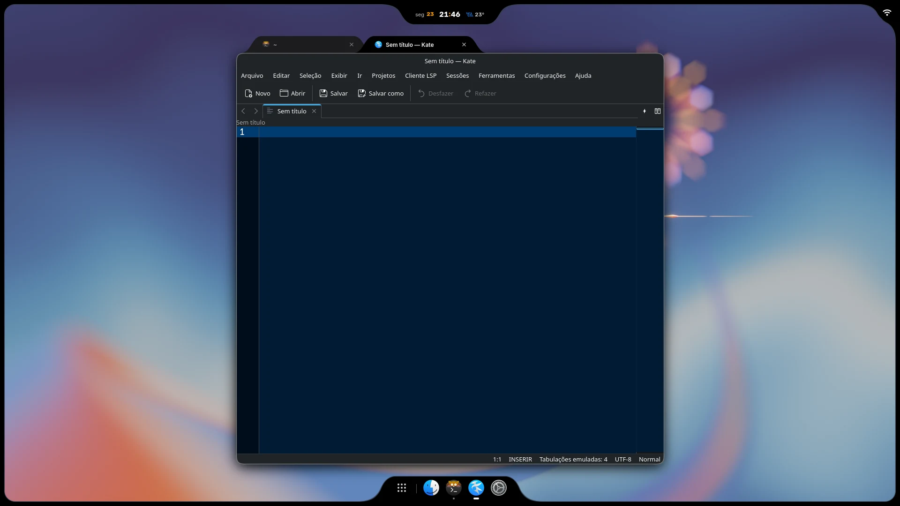
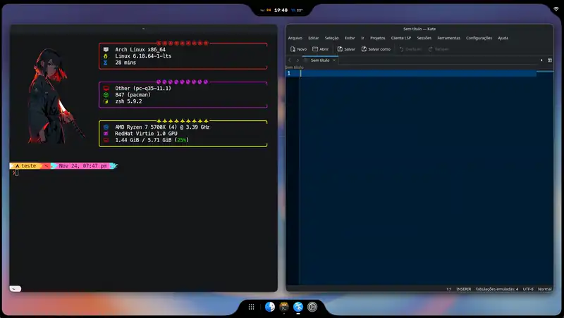
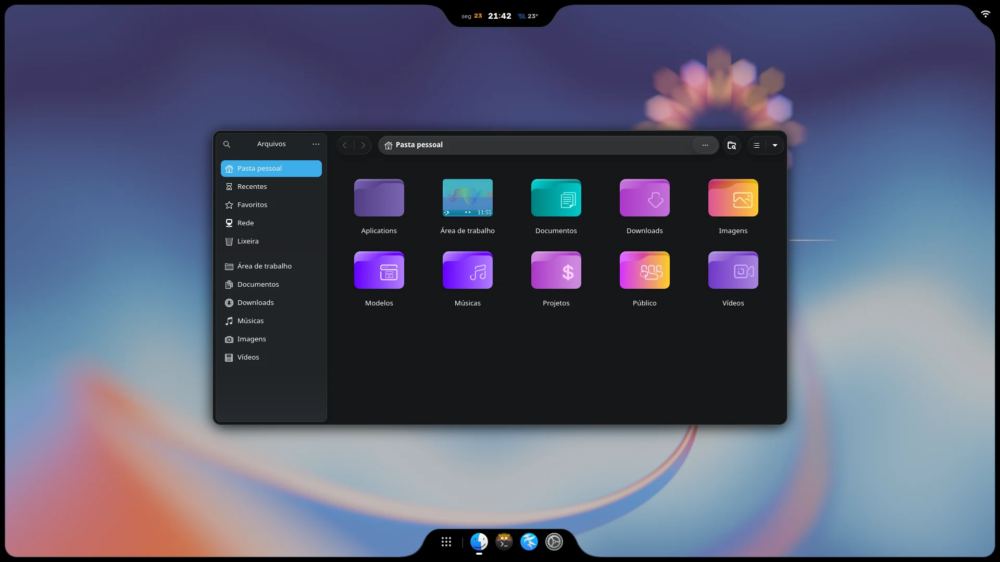
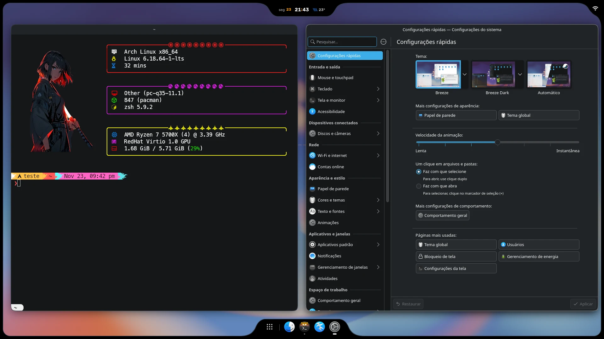
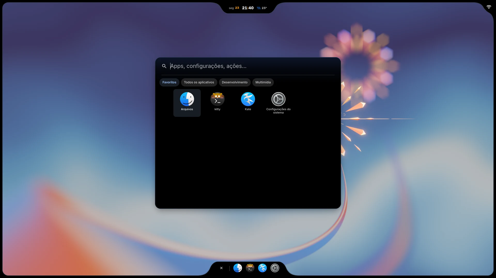
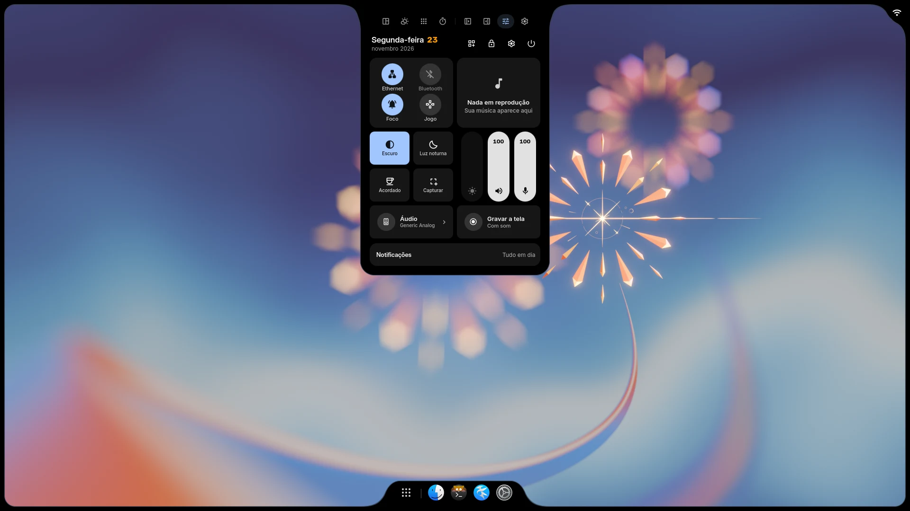
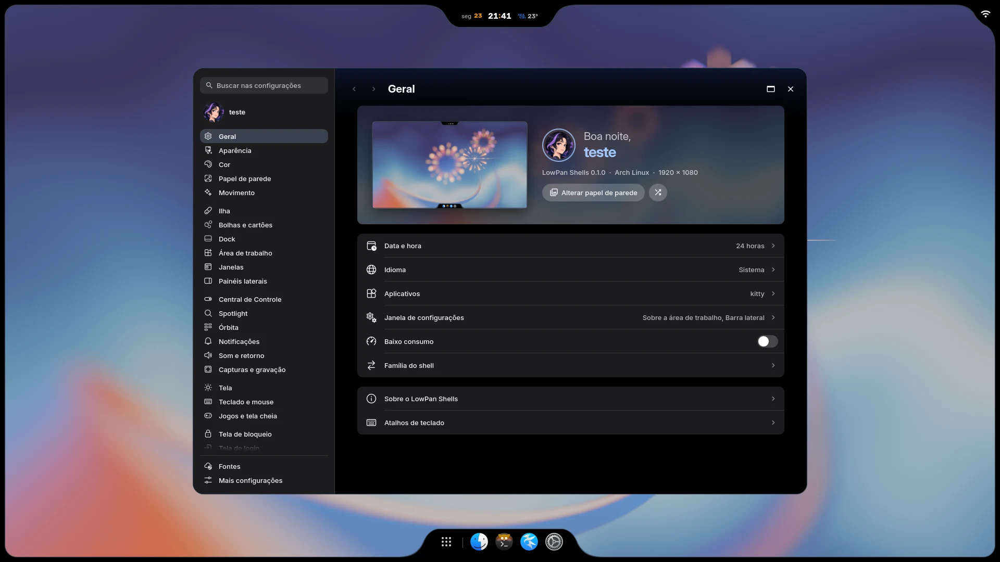
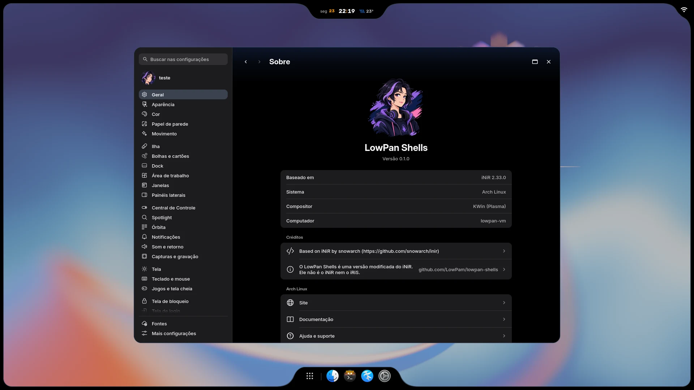
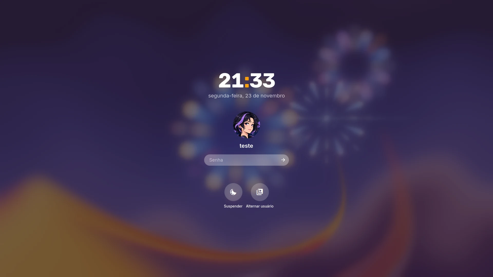
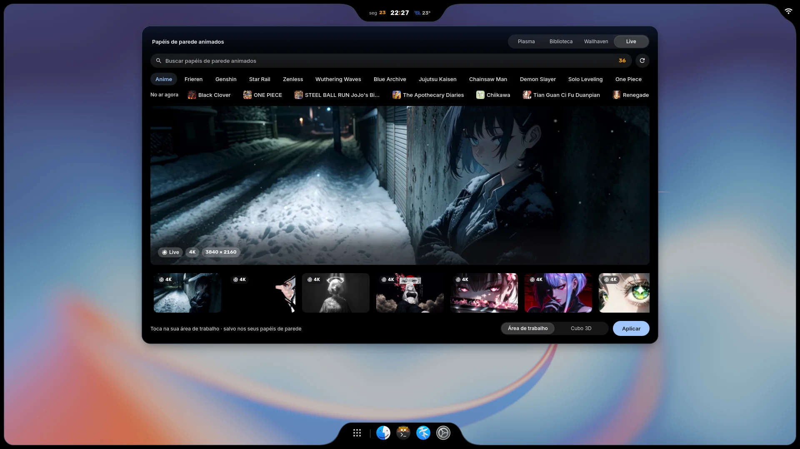

# LowPan Shells

<p align="center"></p>

*[Português](README.md)*

A complete desktop environment, **LowPan**, that runs **on top of KDE Plasma 6** (KWin, Wayland). Plasma stays
installed and untouched as a second environment: pick one on the login screen, or switch between them without
logging out.

**Based on iNiR by snowarch (https://github.com/snowarch/inir)** — LowPan Shells is a modified version of iNiR; it is
not iNiR or iRiS.

> **Preview.** For now LowPan Shells has been validated **only on Arch Linux** (Plasma 6.8, KWin 6.8.3, Wayland), on a
> clean virtual machine and on two real computers. Other distributions are not supported yet: the installer uses
> `pacman` and stops right at the checks if it isn't there.

## Screenshots

<p align="center"><br><sub>Tabbed apps: several windows in one column, with the LowPan tab bar</sub></p>

<p align="center"><br><sub>Join as tab and join the stack: drag one window over another and choose to stack it in the column or group it into tabs · <a href="docs/capturas/aderir-aba-pilha.mp4">watch the video in full quality (MP4)</a></sub></p>

<table>
<tr><td align="center" width="50%"><br><sub>Desktop with the island and the dock</sub></td><td align="center" width="50%"><br><sub>LowPan Tiling: windows in columns</sub></td></tr>
<tr><td align="center" width="50%"><br><sub>Launcher</sub></td><td align="center" width="50%"><br><sub>Control center</sub></td></tr>
<tr><td align="center" width="50%"><br><sub>Settings</sub></td><td align="center" width="50%"><br><sub>About</sub></td></tr>
<tr><td align="center" width="50%"><br><sub>Lock screen</sub></td><td align="center" width="50%"><br><sub>Animated wallpapers</sub></td></tr>
</table>

## What you get

- **LowPan shell** (Quickshell): island top bar, dock, control center, notifications, launcher, wallpapers with
  automatic colors, its own Settings. Derived from [iNiR](https://github.com/snowarch/inir).
- **LowPan Tiling**: [Niri](https://github.com/YaLTeR/niri)-style scrolling columns inside KWin — a Krohnkite fork.
  On or off per environment.
- **Tabbed and stacked apps**: drag one window over another and choose **Join as a tab** (switch from a tab bar, like
  in a browser) or **Join the stack** (both share the column, one above the other).
- **Two isolated environments**: LowPan and Plasma each keep their own theme, tiling and window corners. What you change
  in one doesn't leak into the other.
- **LowPan login screen** (greetd), optional. Your current login manager comes back if you uninstall.
- **Lock screen** with the same look as the login screen, in both environments.
- **Window effects**: TV on open/close, Squash2 on minimize (towards the dock icon), rounded corners. Magic Lamp is
  optional.
- **Themed Nautilus** in LowPan (Dolphin stays in Plasma) and the LowPan screenshot tool (snip, read text, record), or
  Spectacle, your choice.

## Requirements

- Arch Linux (or a derivative with `pacman`)
- KDE Plasma 6 with **KWin 6.8 or newer**, in a **Wayland session**
- `sudo`, `git` and `base-devel` (the rounded corners effect is built during install)
- The project in a folder **without spaces** in its path

No AUR helper needed.

## Install

```sh
git clone https://github.com/LowPam/lowpan-shells.git ~/Aplications/lowpan-shells
cd ~/Aplications/lowpan-shells
./install.sh plano       # shows what it will do, changes nothing
./install.sh instalar    # asks a few questions, shows the plan, asks for OK and applies
```

Run it **from inside a Plasma Wayland session**. The installer follows your system language (English or
Portuguese) and asks:

- screenshot tool: the LowPan one or Spectacle;
- whether to turn on LowPan Tiling;
- login screen: the LowPan one (greetd) or keep the current one (only the LowPan and Plasma sessions are added to it);
- whether to build Magic Lamp (optional);
- turn LowPan on for this session only (recommended the first time) or on every login.

At the end it offers to log out or restart. On the login screen, choose the **LowPan** session.

Everything the installer changes goes into a manifest, with a backup of what was there before. Your Plasma settings
are not overwritten: the Plasma theme is saved as a separate profile before LowPan touches anything.

## Commands

| Command | What it does |
|---|---|
| `./install.sh plano` | shows what would be done; changes nothing |
| `./install.sh instalar` | installs (or completes what's missing) |
| `./install.sh verificar` | checks the install and its health (shell, effects, fonts); read-only |
| `./install.sh atualizar` | `git pull` and installs only what changed |
| `./install.sh desinstalar` | undoes everything from the manifest and removes the packages the installer added |
| `lowpan-shells-switch try` / `on` / `off` | use LowPan now / on every login / back to Plasma |

**Uninstall** must run in a **Plasma** session (inside LowPan it refuses, since it would remove the shell drawing the
screen). It offers to restart at the end.

## If something goes wrong

- **Meta+Ctrl+Alt+P** goes back to Plasma right away (same as `lowpan-shells-switch off`).
- On the login screen, choose the **Plasma** session: it's your usual Plasma.
- `./install.sh desinstalar` (in a Plasma session) leaves the machine as it was.

## If you use Krohnkite

LowPan Tiling is a Krohnkite fork, and the two can't run in the same session. The installer saves your Krohnkite
settings and shortcuts and, **in Plasma**, LowPan Tiling runs with them (same layouts, same keys). Krohnkite stays
installed but off, and is turned back on when you uninstall LowPan Shells.

## Credits

Based on iNiR by snowarch (https://github.com/snowarch/inir). The shell is a modified version of
[iNiR](https://github.com/snowarch/inir), itself from illogical-impulse (end-4); iNiR's terms are in `shell/NOTICE`
(the names "iNiR" and "iRiS", the logos and the mascot are not licensed to derivatives — that's why the environment
here is called LowPan). The tiling is a
[Krohnkite](https://github.com/anametologin/krohnkite) fork. The full list, with licenses, is in
[CREDITS.md](CREDITS.md).

## License

[GPL-3.0](LICENSE).
