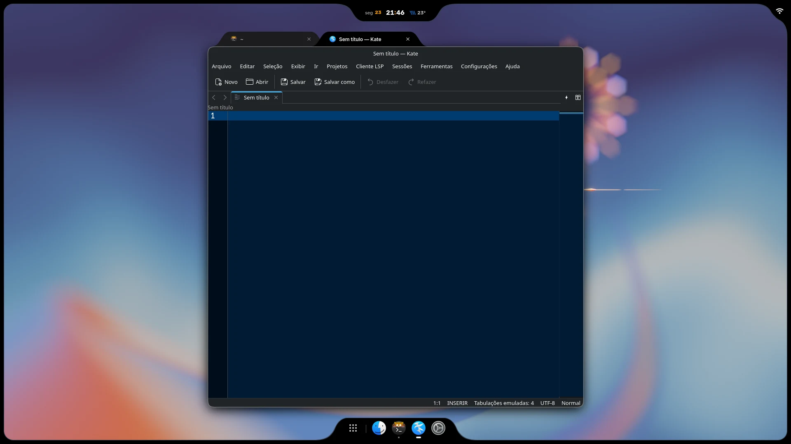
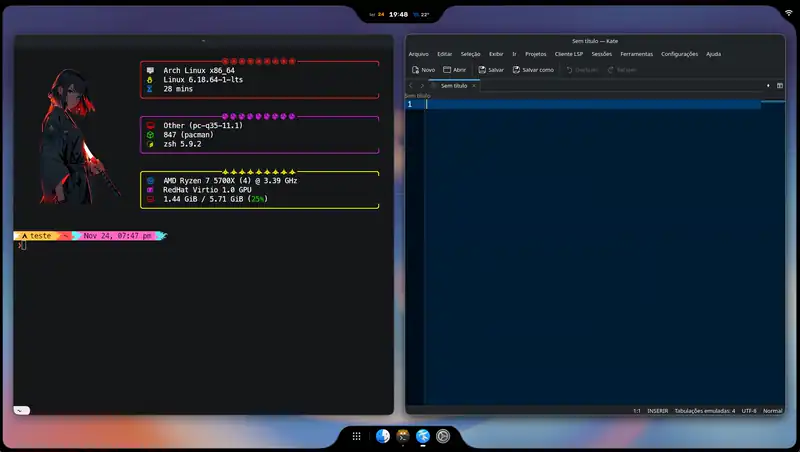
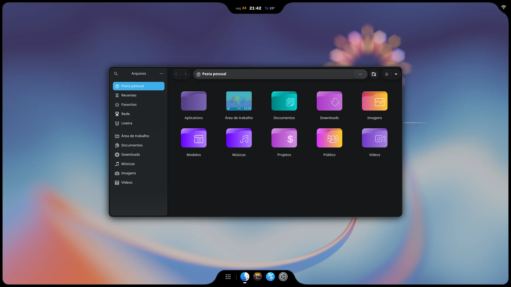
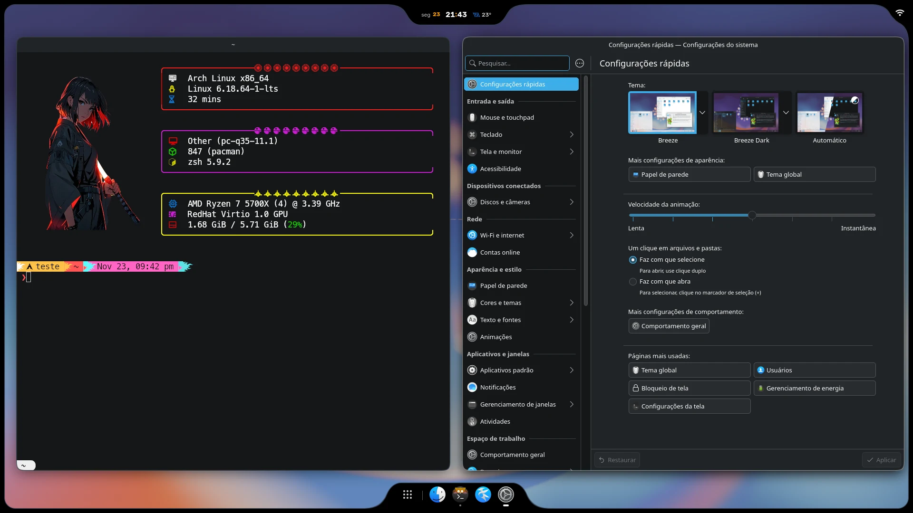
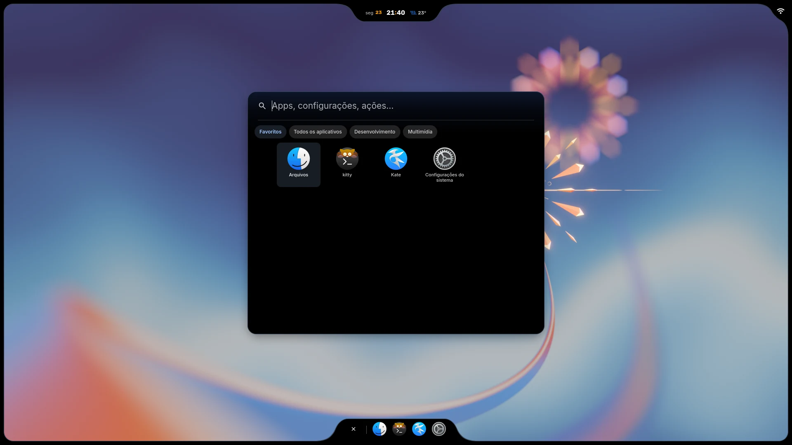
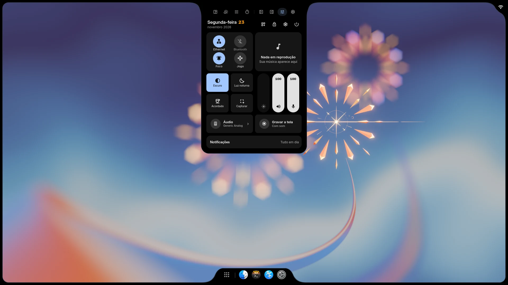
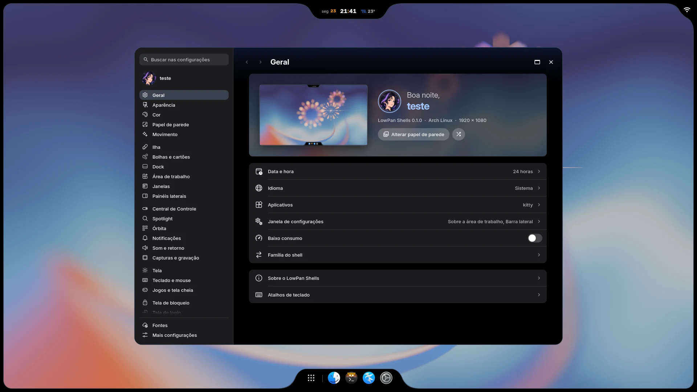
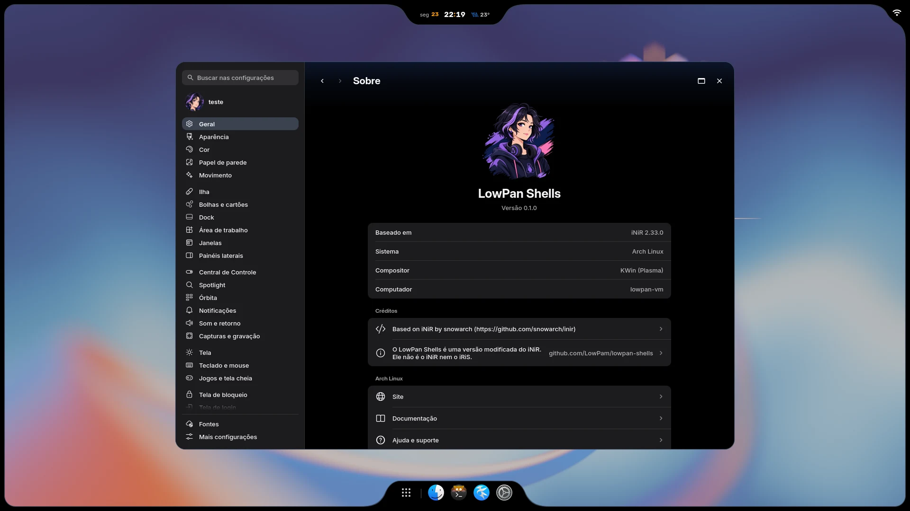
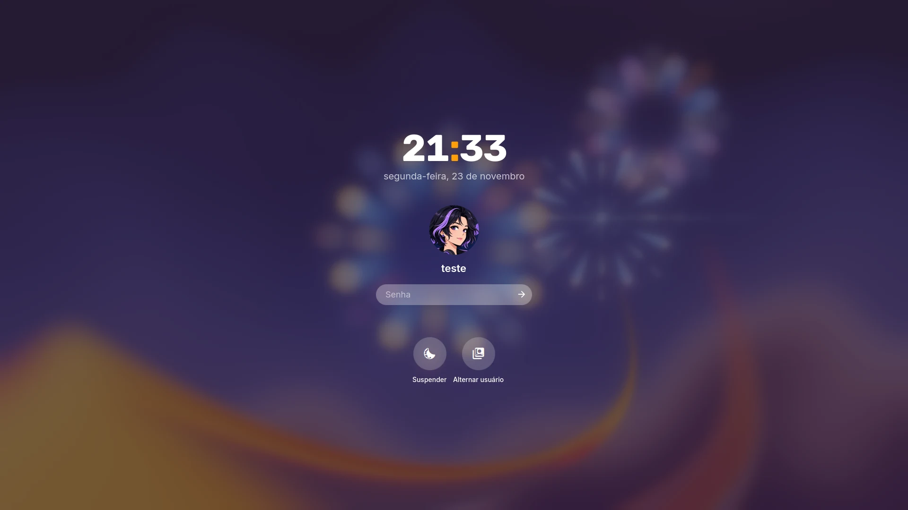
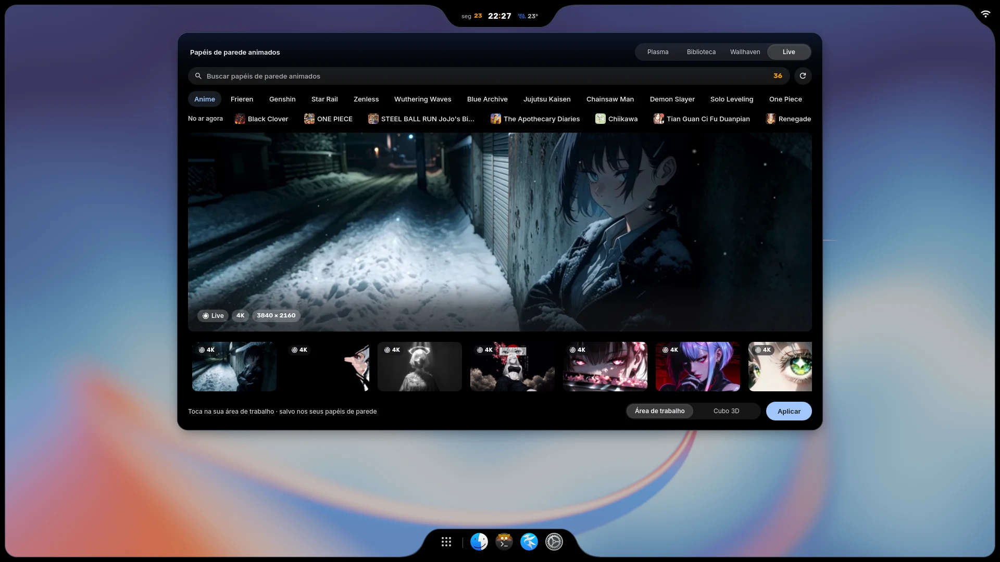

# LowPan Shells

<p align="center"></p>

*[English](README.en.md)*

Um ambiente de trabalho completo, o **LowPan**, que roda **sobre o KDE Plasma 6** (KWin, Wayland). O Plasma continua
instalado e intacto como segundo ambiente: você escolhe qual usar na tela de login, ou troca entre os dois sem sair
da sessão.

**Based on iNiR by snowarch (https://github.com/snowarch/inir)** — o LowPan Shells é uma versão modificada do iNiR;
não é o iNiR nem o iRiS.

> **Prévia.** Por enquanto o LowPan Shells foi validado **só no Arch Linux** (Plasma 6.8, KWin 6.8.3, Wayland), numa
> máquina virtual limpa e em dois computadores reais. Outras distribuições não são suportadas ainda: o instalador usa
> o `pacman` e para logo na checagem se não o encontrar.

## Capturas

<p align="center"><br><sub>Apps em abas: várias janelas numa coluna só, com a barra de abas do LowPan</sub></p>

<p align="center"><br><sub>Aderir à pilha e aderir à aba: arraste uma janela sobre a outra e escolha empilhar na coluna ou juntar em abas · <a href="docs/capturas/aderir-aba-pilha.mp4">ver o vídeo em qualidade cheia (MP4)</a></sub></p>

<table>
<tr><td align="center" width="50%"><br><sub>Área de trabalho com a ilha e a dock</sub></td><td align="center" width="50%"><br><sub>LowPan Tiling: janelas em colunas</sub></td></tr>
<tr><td align="center" width="50%"><br><sub>Lançador</sub></td><td align="center" width="50%"><br><sub>Central de controle</sub></td></tr>
<tr><td align="center" width="50%"><br><sub>Configurações</sub></td><td align="center" width="50%"><br><sub>Sobre</sub></td></tr>
<tr><td align="center" width="50%"><br><sub>Tela de bloqueio</sub></td><td align="center" width="50%"><br><sub>Papéis de parede animados</sub></td></tr>
</table>

## O que vem

- **O shell** (Quickshell): barra superior em ilha, dock, central de controle, notificações, lançador,
  papéis de parede com cores automáticas, Configurações próprias. Derivado do [iNiR](https://github.com/snowarch/inir).
- **LowPan Tiling**: janelas em colunas no estilo do [Niri](https://github.com/YaLTeR/niri), dentro do KWin — fork do
  Krohnkite. Liga e desliga por ambiente.
- **Apps em abas e pilhas**: arraste uma janela sobre outra e escolha **Aderir à aba** (alterna por uma barra de abas,
  como num navegador) ou **Aderir à pilha** (as duas dividem a coluna, uma em cima da outra).
- **Dois ambientes isolados**: o LowPan e o Plasma guardam cada um o seu tema, o seu tiling e os seus cantos de janela.
  O que você muda num não vaza para o outro.
- **Tela de login do LowPan** (greetd), opcional. O gerenciador de login atual volta se você desinstalar.
- **Tela de bloqueio** no mesmo visual da tela de login, nos dois ambientes.
- **Efeitos de janela**: TV ao abrir/fechar, Achatar2 ao minimizar (indo até o ícone na dock), cantos arredondados.
  A Lâmpada Mágica é opcional.
- **Nautilus com tema próprio** no LowPan (o Dolphin continua no Plasma) e captura de tela do LowPan (recorte, ler texto,
  gravar), ou o Spectacle, à sua escolha.

## Requisitos

- Arch Linux (ou derivado com `pacman`)
- KDE Plasma 6 com **KWin 6.8 ou mais novo**, numa **sessão Wayland**
- `sudo`, `git` e `base-devel` (o efeito de cantos arredondados é compilado na instalação)
- O projeto numa pasta **sem espaço** no caminho

Não precisa de helper do AUR.

## Instalar

```sh
git clone https://github.com/LowPam/lowpan-shells.git ~/Aplications/lowpan-shells
cd ~/Aplications/lowpan-shells
./install.sh plano       # mostra o que vai fazer, sem mexer em nada
./install.sh instalar    # faz as perguntas, mostra o plano, pede OK e aplica
```

Rode **de dentro de uma sessão Plasma Wayland**. O instalador pergunta:

- ferramenta de captura: a do LowPan ou o Spectacle;
- se liga o LowPan Tiling;
- tela de login: a do LowPan (greetd) ou manter a atual (só entram as sessões LowPan e Plasma no menu dela);
- se compila a Lâmpada Mágica (opcional);
- ligar o LowPan só nesta sessão (recomendado na primeira vez) ou em todo login.

No fim ele pede para sair da sessão ou reiniciar. Na tela de login, escolha a sessão **LowPan**.

Tudo o que o instalador muda fica num manifesto, com backup do que existia antes. Os seus ajustes do Plasma não são
sobrescritos: o tema do Plasma é guardado como um perfil separado antes de o LowPan mexer em qualquer coisa.

## Comandos

| Comando | O que faz |
|---|---|
| `./install.sh plano` | mostra o que seria feito; não muda nada |
| `./install.sh instalar` | instala (ou completa o que falta) |
| `./install.sh verificar` | confere a instalação e a saúde (shell, efeitos, fontes); só lê |
| `./install.sh atualizar` | `git pull` e instala só o que mudou |
| `./install.sh desinstalar` | desfaz tudo pelo manifesto e remove os pacotes que o instalador trouxe |
| `lowpan-shells-switch try` / `on` / `off` | usar o LowPan agora / em todo login / voltar ao Plasma |

**Desinstalar** precisa ser feito numa sessão **Plasma** (dentro do LowPan ele se recusa, porque tiraria o shell que
está desenhando a tela). No fim ele pede para reiniciar.

## Se algo der errado

- **Meta+Ctrl+Alt+P** volta ao Plasma na hora (o mesmo que `lowpan-shells-switch off`).
- Na tela de login, escolha a sessão **Plasma**: ela é o Plasma de sempre.
- `./install.sh desinstalar` (na sessão Plasma) deixa a máquina como estava.

## Se você usa o Krohnkite

O LowPan Tiling é um fork do Krohnkite, e os dois não podem rodar na mesma sessão. O instalador guarda os seus
ajustes e atalhos do Krohnkite e, **no Plasma**, o LowPan Tiling passa a funcionar com eles (os mesmos layouts e as
mesmas teclas). O Krohnkite fica instalado, porém desligado, e volta ligado quando você desinstala o LowPan Shells.

## Créditos

Based on iNiR by snowarch (https://github.com/snowarch/inir). O shell é uma versão modificada do
[iNiR](https://github.com/snowarch/inir), que por sua vez veio do illogical-impulse (end-4); os termos do iNiR estão
em `shell/NOTICE` (os nomes "iNiR" e "iRiS", os logos e o mascote não são licenciados para derivados — por isso o
ambiente aqui se chama LowPan). O tiling é um fork do
[Krohnkite](https://github.com/anametologin/krohnkite). A lista completa, com as licenças, está em
[CREDITS.md](CREDITS.md).

## Licença

[GPL-3.0](LICENSE).
